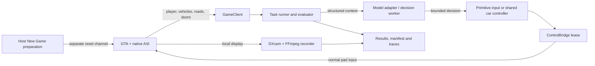

# Architecture

GTA Benchmark separates decisions, execution, task judgment and recording. A
provider adapter can change without changing success criteria or task timing.
The implemented environment is classic San Andreas 1.0 US; other GTA versions
need their own inspected game adapter and are future work.

The recorder has no connection to the model adapter. It captures a local window
region and encodes it on a separate thread. Model requests carry game-state JSON.

## Responsibilities

| Module | Owns |
| --- | --- |
| `config.py` | Shared/local config selection and validation, without native imports |
| `tasks.py` | Task contracts, precondition checks and deterministic evaluators |
| `agents/` | Provider authentication, prompt/choice construction, response validation |
| `runner.py` | Episode clock, worker scheduling, decisions, controls, verdicts and cleanup |
| `navigation.py` | Shared automobile filtering, route planning and driver-door interaction |
| `game.py`, `navigation_state.py` | Fixed-width shared-memory reads and expiring input writes |
| `lifecycle.py` | Host-only install/launch/New Game preparation and starting-state checks |
| `recording.py`, `windows.py` | Game-window capture, independent CFR encoding and finalization |
| `provenance.py` | Source revision, task/config fingerprints and runtime/binary metadata |
| `src/` | Supported-executable gate, native sampling, input/render hooks and reset handling |
| `reader/` | Basic telemetry reader reused by `GameClient`; optional localhost API |

## Episode sequence

1. Validate config/task; create an output directory and snapshots.
2. Optionally install/launch a closed game and prepare New Game through the native
   reset channel. Hold exclusive ownership before changing the session.
3. Check fresh state, render profile, task preconditions and controller readiness.
4. Start video, refresh staging, create the evaluator and start the task clock.
5. Monitor state, evaluate the task and apply bounded decisions until a terminal
   verdict, deadline, cancellation or runtime failure.
6. Freeze task outcome/time/state, release injected input and stop requesting
   decisions. Record the configured aftermath only after success.
7. Finalize the MP4, release ownership, write the final result and return.

`finished_at_utc` and `elapsed_seconds` refer to the task boundary.
`artifacts_finished_at_utc` refers to finalization after optional extra footage.
The same ownership mutex remains held through recording cleanup.

## Independent clocks

| Loop | Schedule |
| --- | --- |
| Game render / local video | 30 FPS / constant 30 FPS file |
| Basic and nearby-vehicle telemetry | 10 Hz |
| Native road/door/clearance sampling | 5 Hz |
| Task monitor | 20 Hz target |
| Car navigation control | 10 Hz target |
| Primitive model decisions | 5 or 10 Hz ceiling, one request in flight |
| Car target selection | When needed, at most once every 2 seconds |

Scheduling rates are targets. Actual observed decision/control rates are logged.
A model worker cannot apply controls itself. A response that arrives too late or
after the task ends cannot extend the task or mutate its verdict.

## Two evaluation modes

`primitive_actions` asks the model for one currently allowed short action. The
runner validates its age and action set, then leases that pad input.

`target_selection_with_road_controller` asks the model to commit to a reachable
automobile. A shared controller follows native road/pedestrian links, handles
vehicle geometry, and presses enter at the driver door. The evaluator scores
the actual driver-seat hold. This mode measures model target selection together
with the shared execution controller. Its controller version is recorded in the
manifest. See [car acquisition](car-acquisition.md).

## Native boundary

The x86 ASI and Python can use different pointer widths. Six named mappings use
fixed-width fields, 4-byte packing and sequence counters. Game pointers never
cross the boundary. The normal action channel accepts codes 0–20 with a live
owner and a lease no longer than 750 ms. World-coordinate goals are converted
to pad movement using current camera orientation every frame.

New Game preparation has a separate acknowledged command channel and session
generation. It is unavailable to model decisions. No arbitrary address-write,
teleport, vehicle-spawn or script-execution command is exposed.

The legacy mapping names and Python module names retain `SAAgent` / `sa_agent`
for compatibility. The public benchmark identity does not require an ABI rename.
See [bridge layouts](bridge.md) and [episode lifecycle](episode-lifecycle.md).
